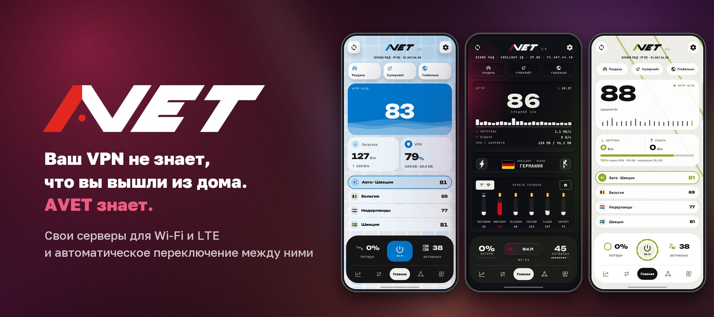
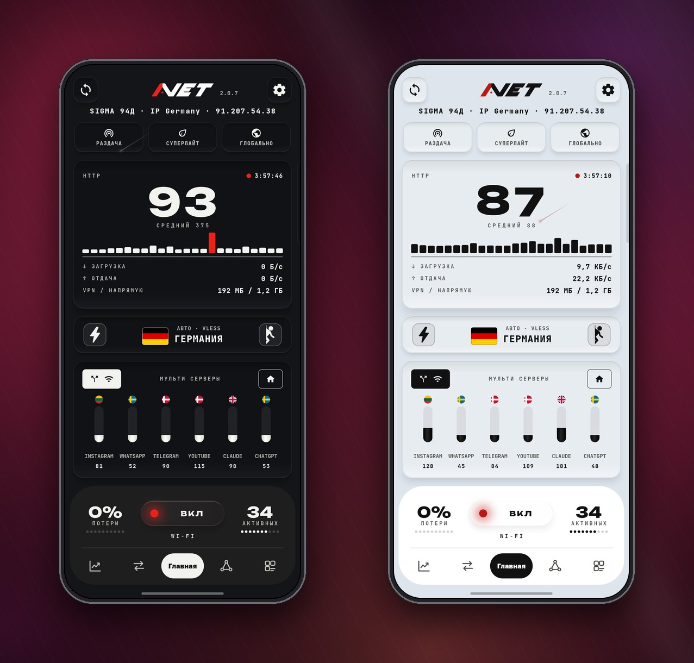
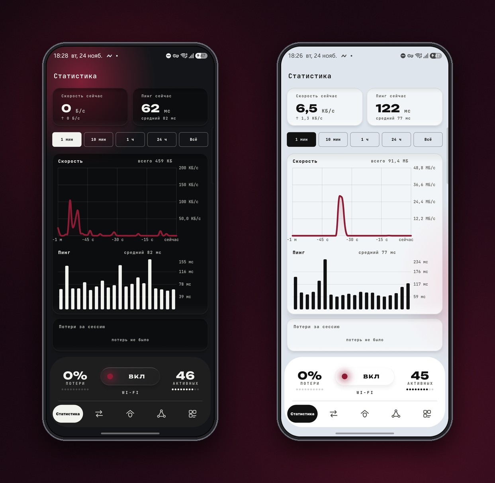
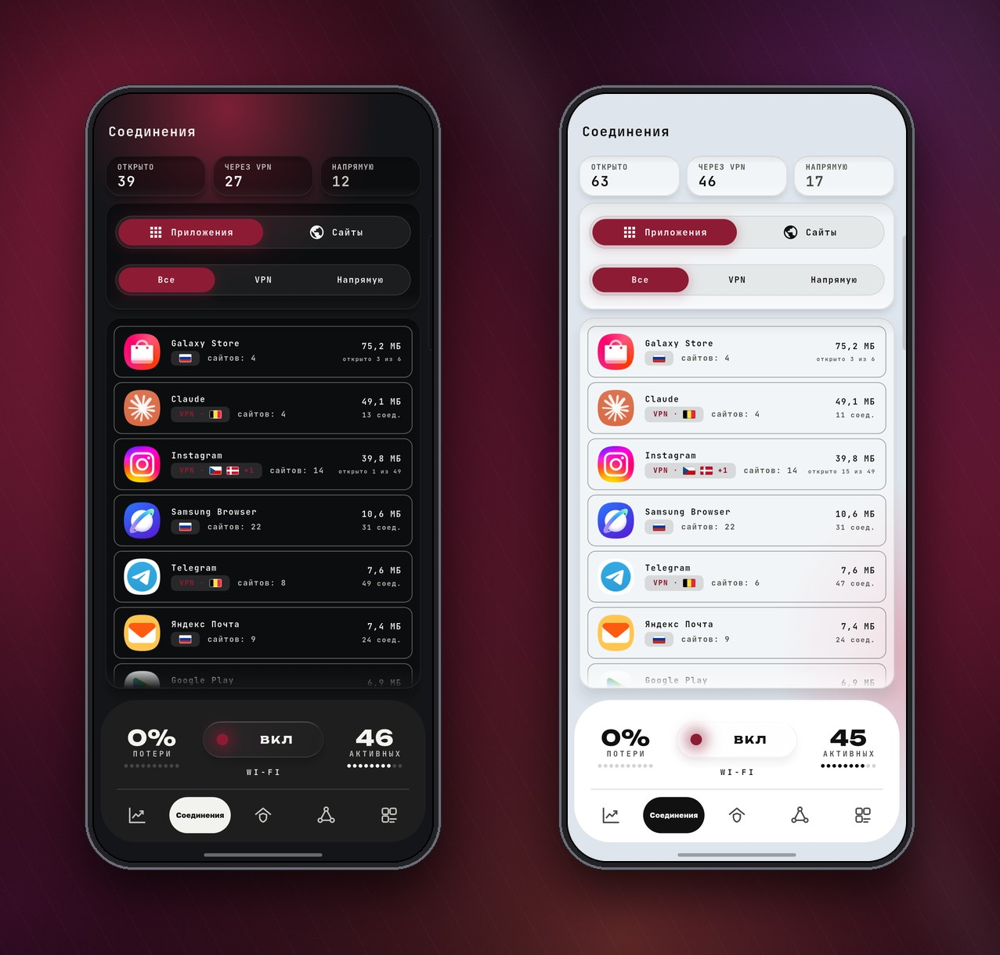
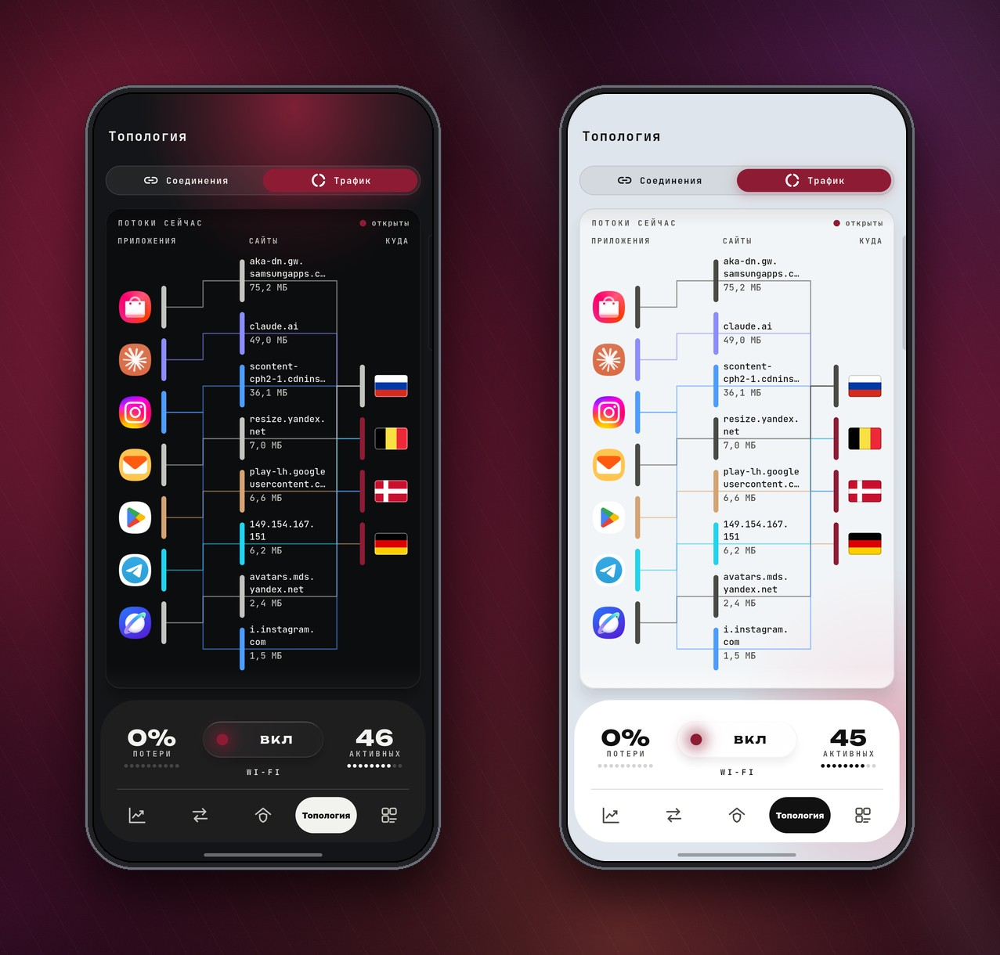
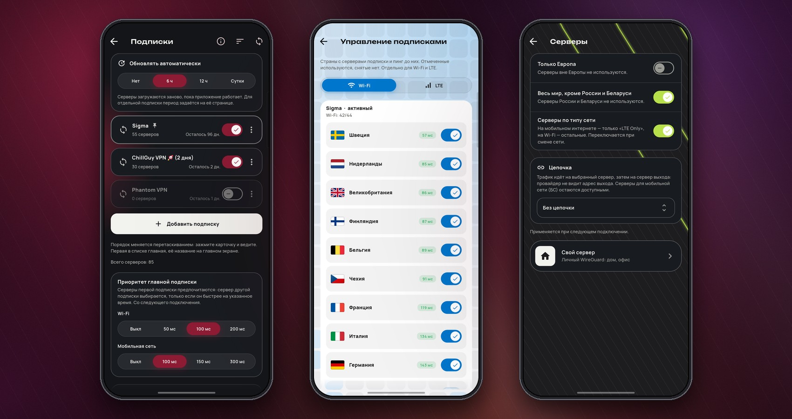
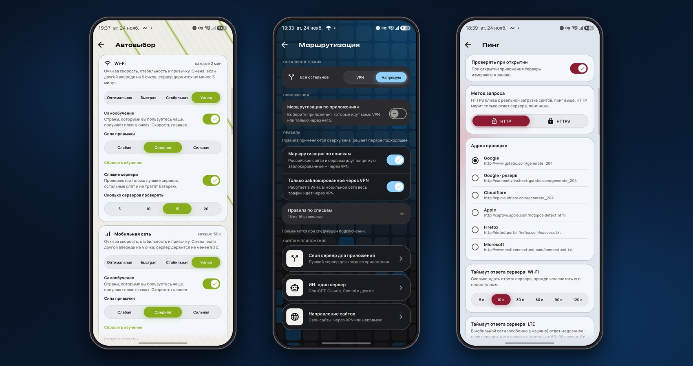
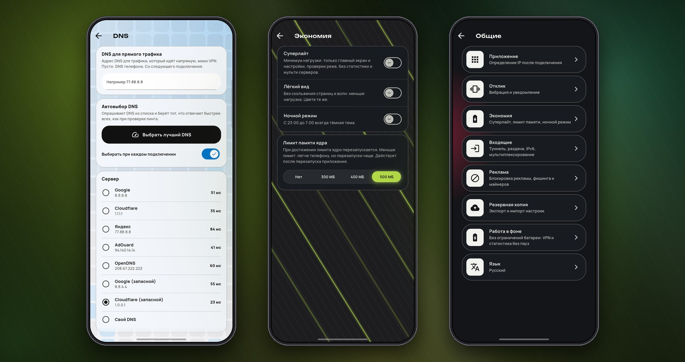
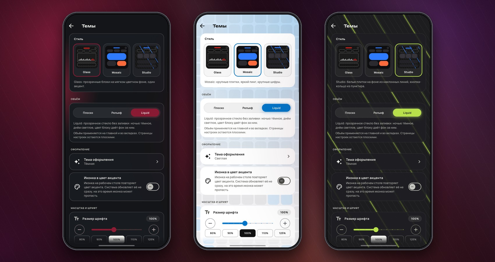
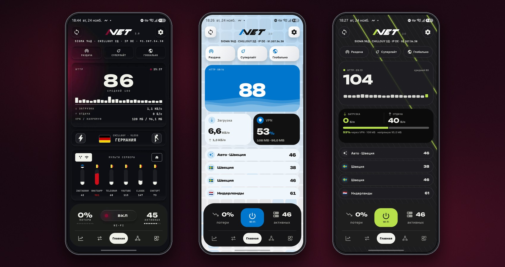

  

  VPN-клиент для Android на ядре <a href="https://github.com/SagerNet/sing-box">sing-box</a>. 
  Отдельные наборы серверов для Wi-Fi и мобильной сети, умный автовыбор, свой сервер для каждого приложения.

  
  
  
  
  

  <a href="../../releases/latest"><b>Скачать APK</b></a> · <a href="../../discussions">Вопросы и идеи</a>

  

## Возможности

### Wi-Fi и LTE: два набора серверов

Дома и в дороге нужны разные серверы. Быстрый по Wi-Fi сервер может работать медленно в сотовой сети, а часть серверов («LTE Only») предназначена только для мобильных операторов. AVET хранит два независимых набора и переключается между ними сам при смене сети.

- Страны и серверы включаются отдельно для каждой сети.
- У каждой сети своё расписание проверок (Wi-Fi: каждые 2 минуты, LTE: каждую минуту) и свои пороги смены сервера.
- Мульти-серверы для приложений и сайтов также разделены по сетям.

### Автовыбор

Четыре режима: оптимальный, быстрый, стабильный и умный. Умный режим оценивает скорость, стабильность и ваши привычки: чаще используемые страны получают дополнительные очки. Спящие серверы не проверяются постоянно, чтобы не расходовать батарею.

### Мульти-серверы

Отдельный лучший сервер для Instagram, Telegram, YouTube, ИИ-сервисов и других приложений и сайтов. Выбор обновляется автоматически и учитывает тип сети.

### Подписки и протоколы

- Несколько подписок одновременно: порядок, автообновление, приоритет главной подписки.
- Форматы ссылок: обычный адрес, `clash://`, `sing-box://`, `v2rayng://`, `hiddify://`, `sub://`.
- Протоколы sing-box: VLESS, VMess, Trojan, Shadowsocks, Hysteria, WireGuard и другие; REALITY, XHTTP; мультиплексирование, IPv6.
- Из ссылок и конфигов понимает перескок портов Hysteria2 (диапазоны портов), ECH и проверку сертификата по SHA-256.
- Если подписка не скачалась без VPN, AVET сам скачает её через туннель сразу после подключения.
- Перед полной проверкой сервера быстрая TCP-проверка порта: недоступные серверы отсеиваются за секунды.

### Маршрутизация

Трафик направляется по спискам, приложениям и сайтам: российские сервисы напрямую, заблокированные ресурсы через VPN. Для отдельных приложений и ИИ-сервисов можно назначить свой сервер.

### Статистика

Скорость, пинг, потери, соединения по приложениям и сайтам, карта трафика и топология потоков. Статистика собирается и при закрытом приложении.

### Экономия и дополнительно

- Суперлайт, ночной режим, лимит памяти ядра.
- Блокировка рекламы, фишинга и майнеров.
- Раздача прокси для других устройств в локальной сети.
- Резервная копия настроек: экспорт и импорт через буфер обмена.
- Обновление из приложения: раз в сутки AVET сама проверяет новые версии на GitHub и предлагает скачать; загрузка с проверкой SHA-256 и установка (также вручную в разделе «О программе»).

### Оформление

Три стиля (Glass, Mosaic, Studio), три объёма (плоско, рельеф, Liquid), светлая и тёмная темы, семь фонов (по умолчанию «Стандартно»: ровный спокойный фон; у Fallen по нему изредка падают метеоры цвета акцента), акцентные цвета (в том числе яркие и неоновые), восемь шрифтов текста и три толщины, четыре шрифта для цифр, масштаб текста, простой режим (лёгкий вид и реже опросы).

Блоки на главной сообщают о событиях: при высоком пинге рамка краснеет, при смене страны вспыхивает зелёным, при переходе на Wi-Fi или мобильную сеть синим или голубым.

  

Fallen: спокойный тёмный или светлый лист, по которому изредка падают приглушённые метеоры цвета акцента. На любом фоне, когда что-то происходит, вспыхивает только свой блок: высокий пинг красным, новая страна зелёным, новый сервер у мульти серверов лаймовым, переход на Wi-Fi синим, на мобильную сеть голубым (анимация вверху страницы).

Иконка на рабочем столе может повторять цвет акцента (необязательная настройка в разделе «Темы»).

## Обзор интерфейса

На изображениях слева тёмная тема, справа светлая.

### Главная

Отклик сети и его среднее значение, скорость, объём трафика через VPN и напрямую, текущий сервер, мульти-серверы приложений и панель управления с индикатором типа сети.

  

### Статистика

График скорости и столбики пинга за выбранный период, от минуты до всего времени наблюдения.

  

### Соединения

Счётчики соединений, список приложений и сайтов с фильтром «Все / VPN / Напрямую», страны серверов и объём трафика.

  

### Топология

Схема маршрутов: приложения, сайты и страны назначения. Выбранное приложение подсвечивает свой путь.

  

### Трафик

Карта трафика по приложениям: размер плитки соответствует объёму, цвет показывает путь (через VPN или напрямую), флаги указывают страны серверов.

  

## Настройки

Страницы настроек показаны в разных стилях и темах.

**Подписки и серверы.** Порядок и срок подписок, страны для Wi-Fi и LTE с пингом, ограничения по регионам, цепочка серверов, собственный WireGuard.

  

**Автовыбор, маршрутизация, пинг.** Режимы выбора и самообучение, правила маршрутизации, метод и таймауты проверки пинга для каждой сети.

  

**DNS, экономия, общие.** Автовыбор DNS, режимы энергосбережения, блокировка рекламы, раздача, резервная копия.

  

**Темы.** Стиль, объём, фон, акцентный цвет, шрифт и толщина текста, шрифт цифр, масштаб текста, простой режим.

  

Три стиля на одних и тех же данных: Glass (прозрачные блоки на мягком фоне), Mosaic (крупные плитки и яркий пинг), Studio (наклонные линии на фоне, кнопка питания в виде кольца). По умолчанию у всех стилей объём Liquid: прозрачное стекло без заливки.

  

## Установка

1. Скачайте `AVET-<версия>-arm64.apk` из [Releases](../../releases).
2. Разрешите установку из этого источника и установите приложение.
3. Добавьте подписку или свой сервер. AVET не содержит серверов.

Требуется Android 7.0 или новее, процессор arm64. Разрешение на VPN и уведомления запрашивается при первом подключении.

## Где тестировалось

Все тесты и сборки AVET делались на подписке [Sigma](https://sigmagate.link/). Это не реклама: AVET не привязан ни к какому сервису и работает с подпиской любого провайдера.

## Лицензия и благодарности

AVET распространяется по лицензии [GPL-3.0](LICENSE).

- [sing-box](https://github.com/SagerNet/sing-box) (SagerNet), GPL-3.0: сетевое ядро.
- [Flutter](https://flutter.dev) и [Riverpod](https://riverpod.dev).
- Шрифты JetBrains Mono, IBM Plex Mono, Roboto Mono, Fira Code, Source Code Pro, Manrope, Golos Text, Unbounded и Noto Color Emoji: SIL Open Font License; Ubuntu Mono: Ubuntu Font Licence.

Приложение является техническим инструментом для работы с сетью. Соблюдение законов своей страны и правил используемых сервисов остаётся на стороне пользователя.

Автор: [aramikkk](https://github.com/aramikkk)
