<p align="center">
  
</p>

<h1 align="center">AVET</h1>

<p align="center">
  VPN-клиент для Android на ядре <a href="https://github.com/SagerNet/sing-box">sing-box</a>:<br>
  несколько подписок, умный автовыбор сервера, свой сервер для каждого приложения и сайта.
</p>

<p align="center">
  
</p>

## Главная идея: у каждой сети свои серверы

Дома на Wi-Fi и в дороге на мобильном интернете нужны разные серверы: что быстро по кабелю, то может тормозить в LTE, а часть серверов (например, «LTE Only») работает только у сотовых операторов. AVET знает об этом и ведёт два независимых набора:

- **На Wi-Fi** работают одни серверы, **на LTE** другие. Страны и серверы для каждой сети включаются отдельно.
- **Своё расписание и своя логика выбора.** Wi-Fi проверяется каждые 2 минуты, мобильная сеть каждую минуту, пороги пинга и смены сервера настраиваются для каждой сети отдельно.
- **Переключение само.** Вышли из дома, Wi-Fi пропал, и AVET уже на серверах для LTE; вернулись, и он снова на домашнем наборе. Ничего нажимать не нужно.
- **Мульти-серверы тоже по сетям.** Лучший сервер для Instagram, Telegram, YouTube и ИИ-сервисов выбирается отдельно для Wi-Fi и отдельно для LTE.

## Что умеет

- **Несколько подписок сразу.** Ссылки в любом привычном виде (обычный адрес, `clash://`, `sing-box://`, `v2rayng://`, `hiddify://`, `sub://`), перетаскивание для порядка, автообновление, приоритет главной подписки.
- **Умный автовыбор.** Сервер выбирается по очкам за скорость, стабильность и привычку; самообучение по тому, чем вы пользуетесь; «спящие» серверы не тратят батарею; отдельные настройки для Wi-Fi и мобильной сети.
- **Мульти-серверы.** Лучший сервер для каждого приложения и сайта отдельно (Instagram, Telegram, YouTube, ИИ-сервисы и другие), отдельно для Wi-Fi и LTE.
- **Маршрутизация.** По спискам, по приложениям, по сайтам; российские сервисы напрямую, заблокированное через VPN.
- **Статистика и трафик.** Скорость, пинг, потери, соединения по приложениям и сайтам, топология потоков, плитки трафика по приложениям.
- **Суперлайт и экономия.** Режим минимальной нагрузки, ночной режим, лимит памяти ядра, сбор статистики при закрытом приложении.
- **Транспорты.** Всё, что поддерживает sing-box (VLESS, VMess, Trojan, Shadowsocks, Hysteria, WireGuard и другие), в том числе REALITY и XHTTP; мультиплексирование, IPv6.
- **Раздача.** Прокси для других устройств в локальной сети, с паролем.
- **Резервная копия настроек.** Экспорт и импорт через буфер обмена.
- **Внешний вид.** Три стиля (Glass, Mosaic, Studio), четыре объёма (плоско, рельеф, стекло, Liquid), светлая и тёмная темы, шесть фонов, много акцентных цветов, четыре шрифта цифр, масштаб текста.

## Скриншоты

Тёмная тема:

<p>
  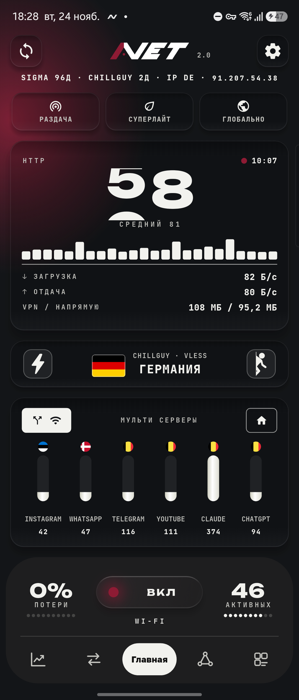
  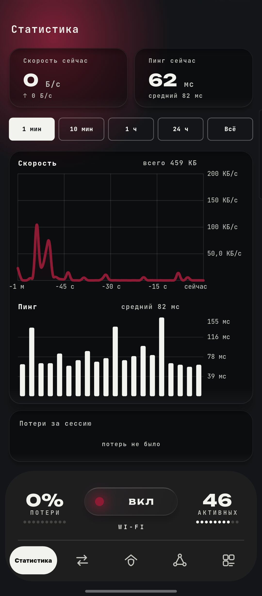
  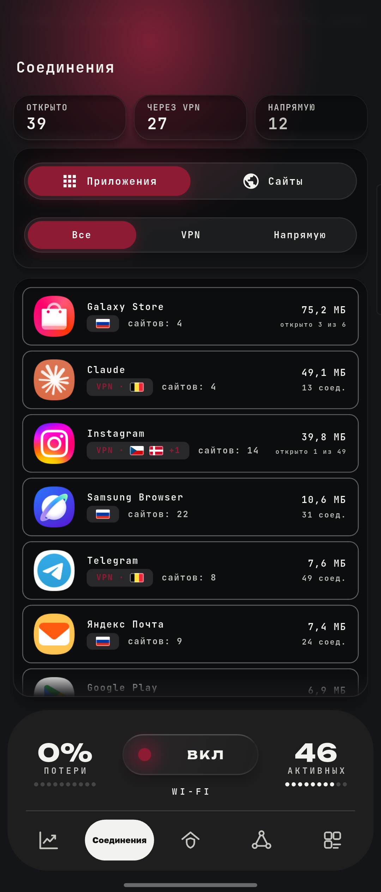
  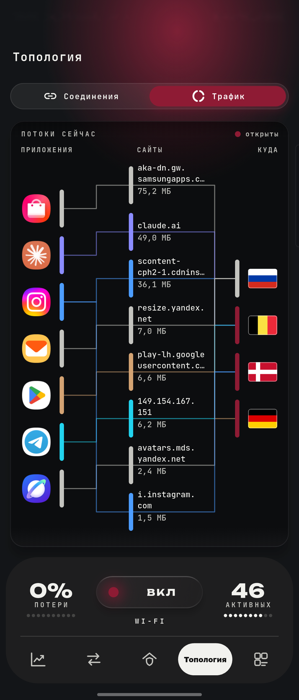
  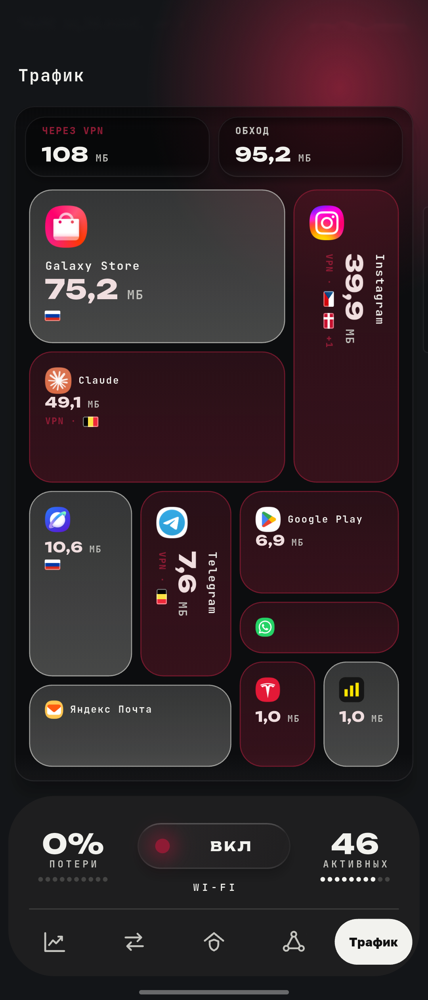
</p>

Светлая тема, три стиля:

<p>
  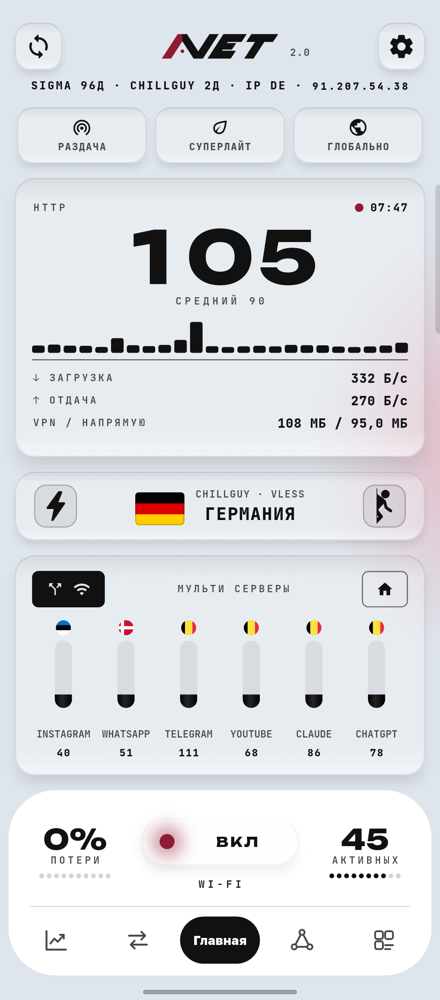
  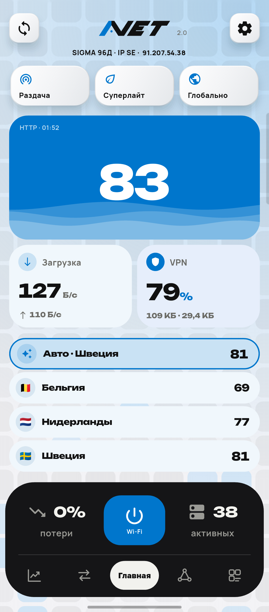
  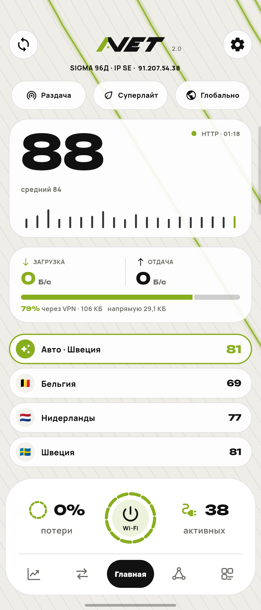
  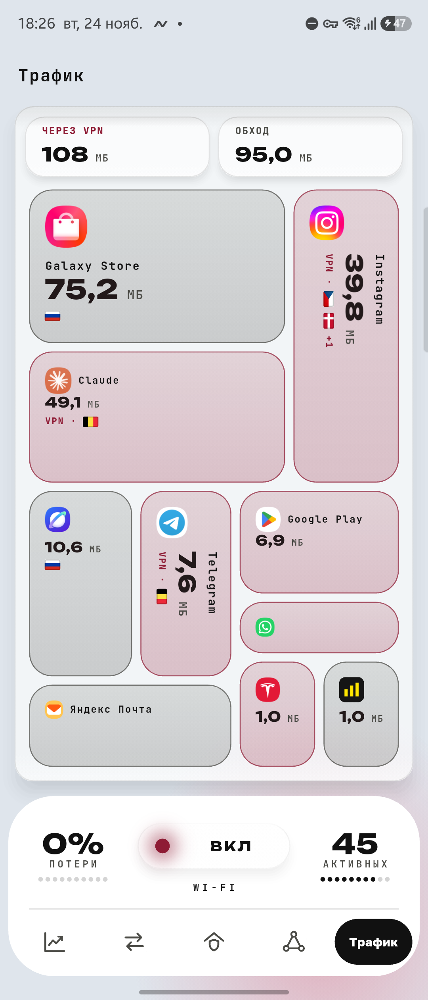
</p>

Настройки:

<p>
  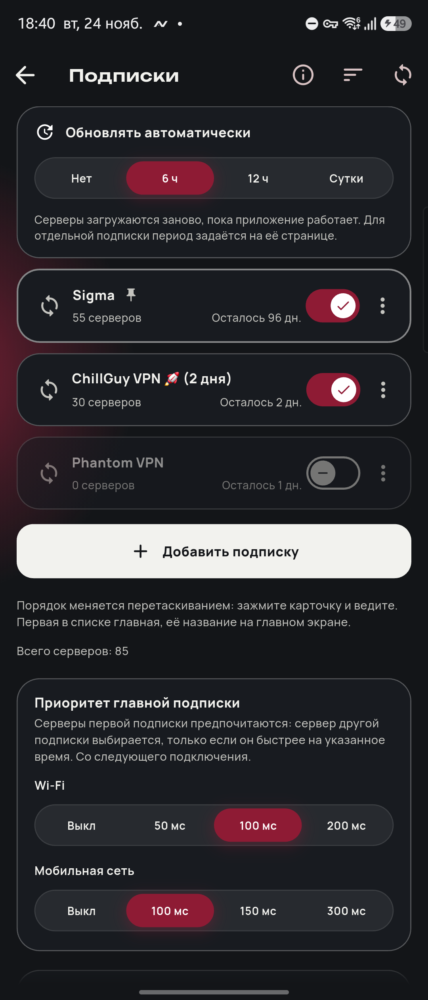
  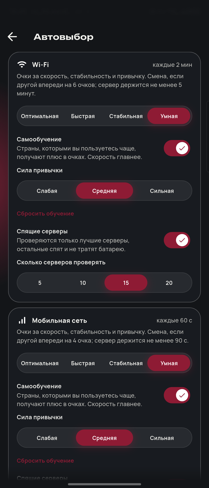
  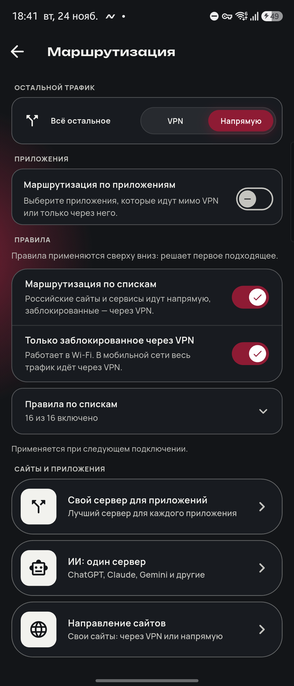
  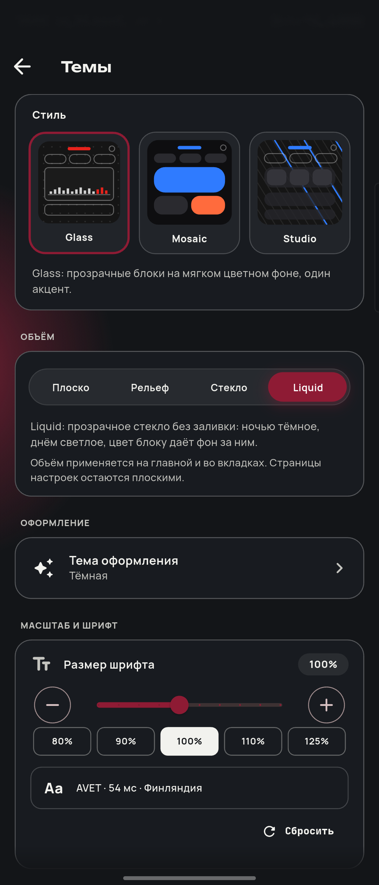
</p>

## Установка

Скачайте APK из [Releases](../../releases) (Android 7.0 и новее, arm64) и установите. Разрешение на VPN и уведомления система спросит при первом подключении.

AVET не содержит серверов: нужна подписка или собственный сервер.

## Структура

- `app/` — приложение на Flutter (Dart) и Android-обвязка на Kotlin (`app/android`).
- `core/` — ядро: `libbox` из sing-box и свой слой `avcore`; патчи к sing-box (`core/smart`, `core/timeout`, `core/patch-singbox.sh`), сборка AAR: `core/build-android.sh`.
- `app/android/app/libs/avcore.aar` — собранное ядро (arm64), чтобы приложение собиралось без Go.
- `brand/` — логотип и иконки.
- `docs/` — скриншоты для README.

В коде есть и заготовка для Windows (`app/windows`), но она не выпускается.

## Сборка

Нужны Flutter (Dart `^3.10`) и Android SDK.

```
cd app
flutter pub get
flutter test
flutter build apk --release --target-platform android-arm64
```

Для подписи релиза создайте `app/android/key.properties` (`storeFile`, `storePassword`, `keyAlias`, `keyPassword`); без него сборка подписывается отладочным ключом.

Ядро пересобирать не обязательно. Если нужно: Go, `gomobile` и Android NDK, затем `core/build-android.sh` (скрипты написаны под окружение автора, пути в начале файлов нужно поправить). Версия sing-box: 1.14.4.

## Благодарности и лицензия

- [sing-box](https://github.com/SagerNet/sing-box) (SagerNet), GPL-3.0 — ядро.
- [Flutter](https://flutter.dev) и [Riverpod](https://riverpod.dev).
- Шрифты JetBrains Mono, Manrope, Golos Text, Unbounded и Noto Color Emoji распространяются по лицензии SIL Open Font License.

AVET распространяется по лицензии **GPL-3.0** (см. `LICENSE`).

Приложение — технический инструмент для работы с сетью. Соблюдать законы своей страны и правила используемых сервисов должен пользователь.

Автор: [aramikkk](https://github.com/aramikkk).
